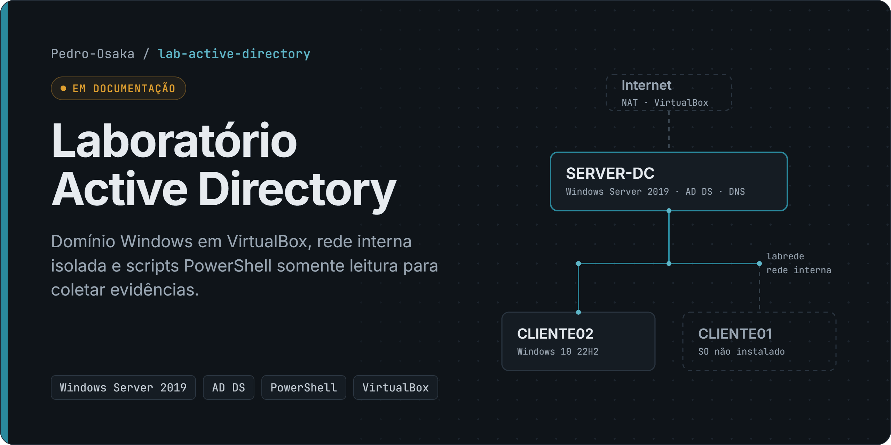

# Laboratório Active Directory (VirtualBox)

> **Status: em documentação.** O ambiente existe e foi usado em maio de 2026. **As evidências ainda não foram coletadas** e nenhum item abaixo é apresentado como concluído sem prova em [`evidencias/`](evidencias/).

Ambiente de estudo de infraestrutura Microsoft: um controlador de domínio Windows Server e estações Windows 10 em rede interna isolada, para praticar AD DS, DNS, DHCP, OUs, grupos, GPO e permissões, as mesmas tarefas do meu dia a dia no suporte.

**[Portfólio](https://pedro-osaka.github.io/portfolio/)** · **[Perfil no GitHub](https://github.com/Pedro-Osaka)**

## Problema

Praticar, num ambiente isolado e descartável, as tarefas de infraestrutura Microsoft que faço no suporte (domínio, DNS, DHCP, OUs, grupos, GPO e permissões), e registrar cada etapa com evidência verificável em vez de só descrevê-la.

## Topologia

```
                 Internet
                    │ NAT (VirtualBox)
            ┌───────┴────────┐
            │   SERVER-DC    │  Windows Server 2019 (Evaluation, build 17763)
            │ 2 vCPU · 4 GB  │  AD DS · DNS · DHCP (planejado)
            └───────┬────────┘
                    │ rede interna "labrede" (isolada do host)
          ┌─────────┴──────────┐
  ┌───────┴────────┐  ┌────────┴───────┐
  │   CLIENTE02    │  │   CLIENTE01    │
  │ Windows 10 22H2│  │ VM criada, SO  │
  │ 2 vCPU · 2 GB  │  │ não instalado  │
  └────────────────┘  └────────────────┘
```

## Ambiente (extraído da configuração das VMs)

| VM | Sistema | vCPU | RAM | Rede | Disco usado | Situação |
|---|---|---|---|---|---|---|
| SERVER-DC | Windows Server 2019 (64 bits), mídia de avaliação 17763 | 2 | 4 GB | NIC1: rede interna `labrede` · NIC2: NAT | ~11 GB | SO instalado |
| CLIENTE02 | Windows 10 22H2 pt-BR (64 bits) | 2 | 2 GB | NIC1: rede interna `labrede` | ~12,7 GB | SO instalado |
| CLIENTE01 | Windows 10 (64 bits) | 2 | 2 GB | NIC1 | 2 MB | **SO não instalado** |

Hipervisor: Oracle VirtualBox 7.2. Os dados vêm do `VBoxManage showvminfo` e dos arquivos `.vbox`/`.vdi` em 11/11/2026. O estado interno dos servidores (papéis, OUs, GPOs) **ainda não foi verificado**: é para isso que servem os scripts abaixo.

## Tecnologias

Oracle VirtualBox 7.2 · Windows Server 2019 (AD DS, DNS, DHCP) · Windows 10 22H2 · PowerShell 5.1

## Demonstração

Ainda **não há capturas de tela**: elas entram junto com as evidências, depois que os scripts forem executados nas VMs. O diagrama da capa e a topologia acima foram feitos a partir da configuração real das VMs.

## Roteiro e checklist de evidências

| # | Etapa | Evidência esperada | Status |
|---|---|---|---|
| 1 | Instalar AD DS e promover o SERVER-DC (nova floresta) | `02-papeis`, `04-dominio`, `05-floresta` | a comprovar |
| 2 | Zonas DNS integradas ao AD (direta e reversa) | `12-dns-zonas` | a comprovar |
| 3 | Escopo DHCP na rede `labrede` | `13-dhcp-escopos`, `14-dhcp-opcoes` | a comprovar |
| 4 | OUs por tipo de objeto e departamento | `06-ous` | a comprovar |
| 5 | Usuários e grupos de segurança fictícios | `07-grupos`, `08-usuarios` | a comprovar |
| 6 | Ingresso do CLIENTE02 no domínio e logon com usuário do domínio | `09-computadores` (DC) · `02-dominio`, `03-canal-seguro` (cliente) | a comprovar |
| 7 | GPO de mapeamento de unidade e políticas de segurança | `10-gpos`, `11-gpo-links` (DC) · `06-gpresult`, `07-unidades` (cliente) | a comprovar |
| 8 | File Server com permissões NTFS por grupo | `15-compartilhamentos` + capturas das permissões | a comprovar |
| 9 | Saúde do domínio | `16-dcdiag` | a comprovar |
| 10 | Instalar o Windows no CLIENTE01 e repetir a etapa 6 | — | pendente |

## Como executar

Os scripts são **somente leitura**: fazem apenas consultas (`Get-*`, `dcdiag`, `ipconfig`, `gpresult`) e salvam um `.txt` por tópico. Se um papel não estiver instalado, a falha é registrada e a coleta continua.

```powershell
# No SERVER-DC, como administrador do domínio:
powershell -NoProfile -ExecutionPolicy Bypass -File .\scripts\Coletar-EvidenciasDC.ps1

# No CLIENTE02, logado com um usuário do domínio:
powershell -NoProfile -ExecutionPolicy Bypass -File .\scripts\Coletar-EvidenciasCliente.ps1
```

Depois, copie as pastas geradas para `evidencias/`, **revise o conteúdo** (veja [`evidencias/README.md`](evidencias/README.md)) e marque as etapas comprovadas no checklist acima.

## Testes

Validação dos scripts (11/11/2026): sem erros de sintaxe no parser do Windows PowerShell 5.1. O script de cliente foi executado numa máquina fora de domínio e registrou corretamente as falhas esperadas (canal seguro e DNS do domínio), sem interromper a coleta. O script do DC ainda não foi executado num controlador de domínio.

## Limitações e status

**Status atual: em documentação.** O ambiente existe; as evidências ainda não foram coletadas.

- Ambiente de estudo, não de produção: um único DC, sem redundância nem backup do estado do sistema.
- Windows Server em mídia de avaliação (licença temporária).
- As capturas de tela ainda não foram feitas.

## Autor

**Pedro Henrique da Silva Pereira** · [Portfólio](https://pedro-osaka.github.io/portfolio/labs/lab-001.html) · [LinkedIn](https://www.linkedin.com/in/pedrosilva-sistemas/)
